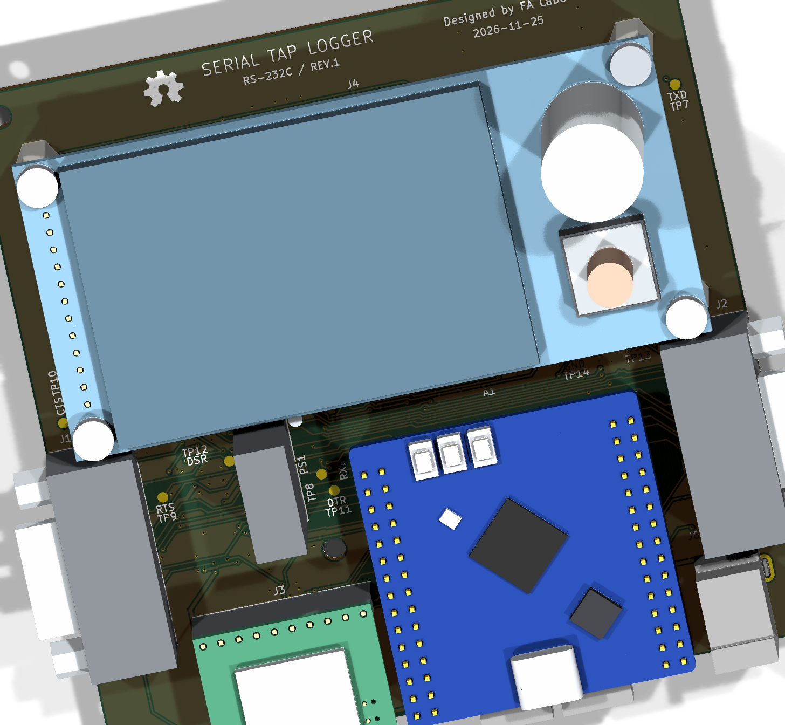
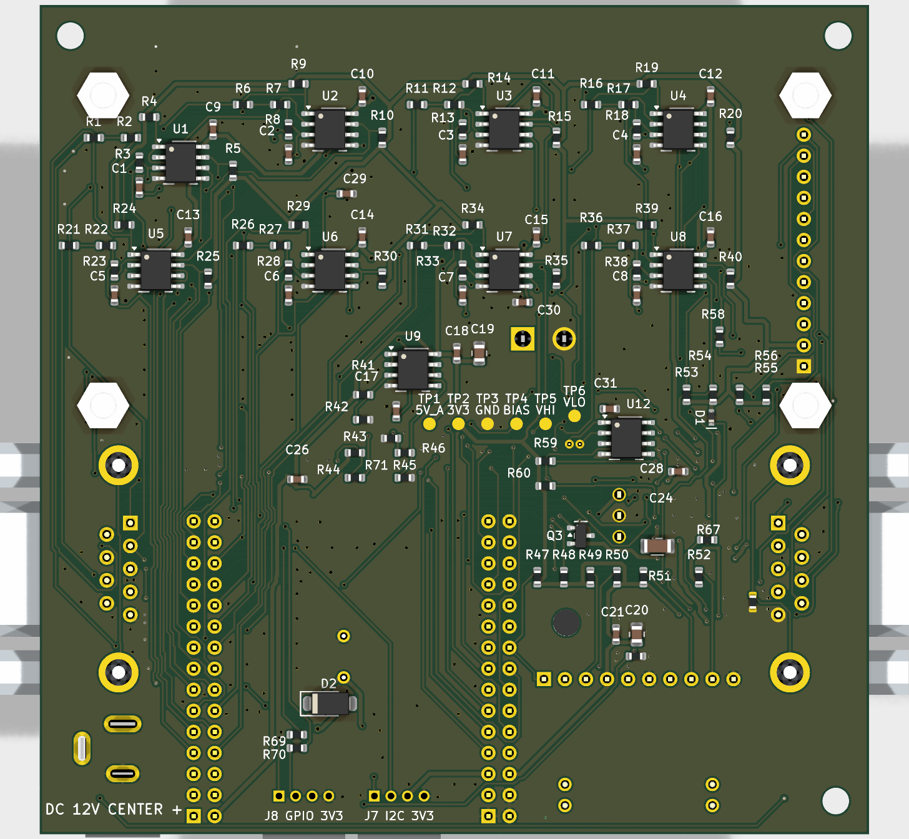
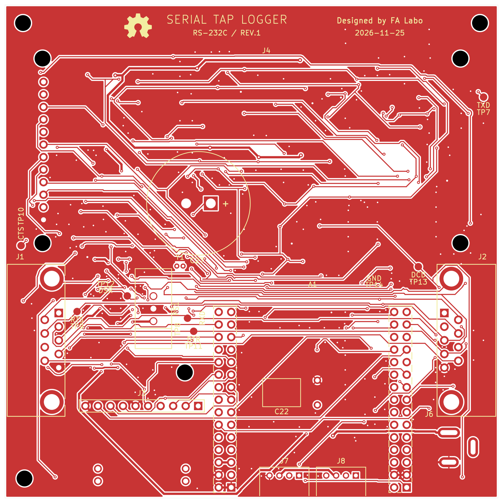
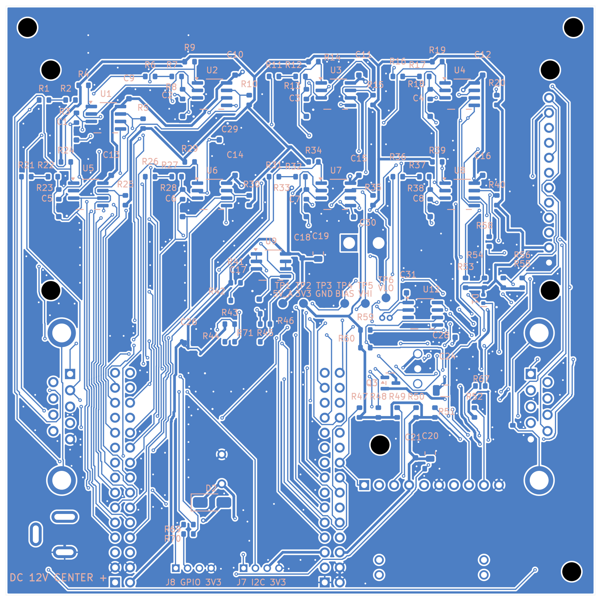
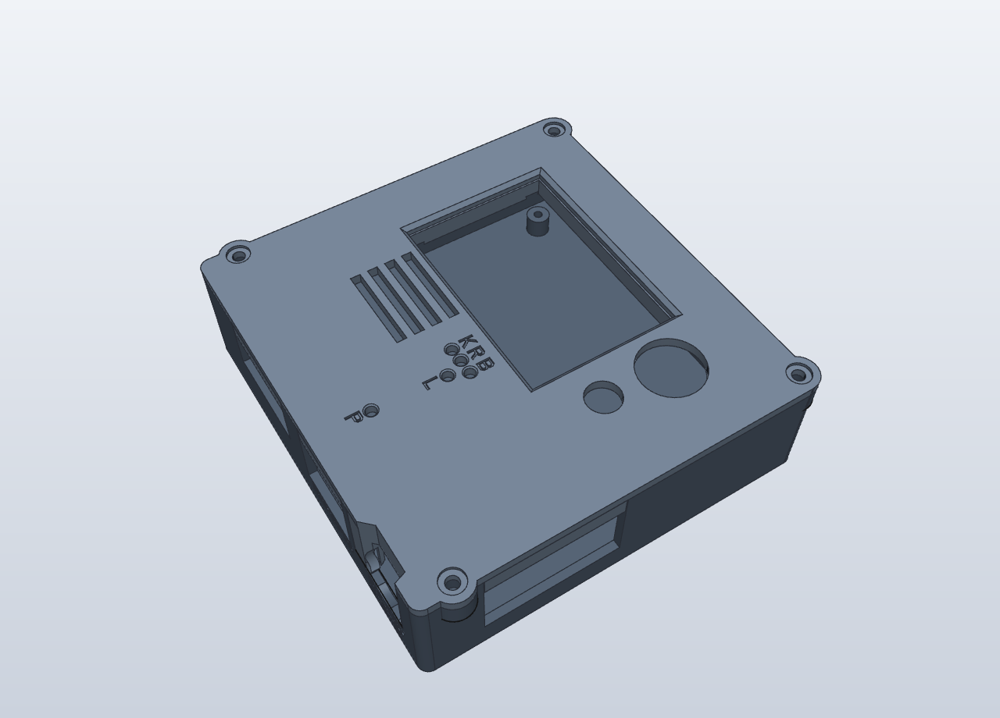

# Serial Tap Logger | RS-232C Rev.1

RS-232C機器2台の間にDE-9オス・メスで挿入し、送受信データと制御線の計8本をmicroSDに記録するロガー。各線を200 kΩ以上の抵抗で分岐し、DE-9の全9ピンを同じ番号で中継します。

## 現在の状況

Rev.1の基板と製造用データを作成済みです。ERC・DRC・未配線・回路図との不一致は各0件。裏面のBOMと実装座標は104点で照合済みです。記録ファームウェアは開発中で、記録性能とケースの嵌合は試作機で確認します。[作業状況と検証結果](docs/Work_Status.md)

## 接続例

[RS-232Cの接続例](docs/Wiring-RS232C.md)に、DE-9オス・メスの挿入位置、送受信を観測する配線、本体電源のつなぎ方を示します。

## 設計・製造資料

| 目的 | 資料 |
| --- | --- |
| 手はんだ部品を用意する | [手はんだ部品表](pcb/manufacturing/Hand_Assembly_BOM.csv) |
| JLCPCBに実装を依頼する | [JLCPCB実装部品表](pcb/manufacturing/PCBA_BOM.csv) |
| 回路を確認する | [回路図PDF](docs/Serial_Tap_Logger_RS232C_Rev1.pdf)・[KiCadデータ](pcb/) |
| 設計と寸法を確認する | [設計資料](docs/Design_Notes.md)・[ピン照合表](docs/Pin_Mapping.csv)・[基板STEP](enclosure/3d-models/Serial_Tap_Logger_RS232C_Rev1_PCBA.step)・[ケース組立](enclosure/drawings/Case_Print_Rev1.md) |
| 基板を製造・実装する | [入稿ファイルと発注条件](docs/Manufacturing.md)・[手はんだ実装図](enclosure/drawings/Hand-Solder-Assembly-Rev1.pdf) |
| 検証結果を確認する | [作業状況と残件](docs/Work_Status.md)・[検証レポート一覧](docs/verification/) |

## 基板の外観

| 表面（操作側）の実装3D図 | 裏面（工場実装側）の実装3D図 |
| --- | --- |
|  |  |

| 表面の配線（F.Cu） | 裏面の配線（B.Cu） |
| --- | --- |
|  |  |

## 主な仕様

| 項目 | 内容 |
| --- | --- |
| 対象 | RS-232C（±3〜±25 V）、115,200 bpsまでが設計目標 |
| 観測 | TXD・RXD・RTS・CTS・DTR・DSR・DCD・RIを正・負・開放（0 V付近）の3状態で判別。RIを除く7本の線路電圧も推定 |
| 記録と操作 | microSD（SDHC）、2.4インチ液晶、ロータリーエンコーダー |
| 基板 | 100 × 100 mm、2層。裏面を工場実装し、コネクタとモジュールを表面に手はんだ |
| 拡張端子 | Grove 2口（J7 I²C、J8 GP22／GP24、各3.3 V） |
| ケース | 3Dプリント用。幅121.1 × 奥行114.05 × 高さ32.8 mm（樹脂ケース単体） |

**測定中はUSBでPCに接続しない。** 電源はDC出力が接地されていない安定化12 V・1 AのACアダプター（外径5.5 mm、内径2.1 mm、センタープラス）を使用します。ログは測定後にmicroSDを取り出して読み込みます。[対応アダプターの例](https://akizukidenshi.com/catalog/g/g117429/)

## 主な部品と選定理由

- **WeAct RP2350B**。PIOで8本の状態を同時に取り込み、ADCで7本の線路電圧を推定するために使います。
- **窓型比較器**。各線の正・負・開放（0 V付近）を判別します。公称の判定点は線路換算で＋2.42 Vと−2.17 Vです。
- **PCF8563と電気二重層コンデンサー**。ログに日時を付け、電源を切っている間も時計を保持します。

## 3Dプリント用ケース

ふたはM3の熱圧入インサートとM3×6 mmねじ各4個で固定します。組立手順で、液晶の支持部品、左右のDE-9の取り付け、前面端子の差し込み寸法を確認できます。

[ケース3D（GitHubブラウザー表示）](enclosure/3d-models/Case_Browser.stl)・[ケースSTEP](enclosure/3d-models/Case_Print_Rev1.step)・[編集用SolidCraftモデル](enclosure/3d-models/Case_Print_Rev1.sc)・[底STL](enclosure/print/Case_Print_Rev1_Tray.stl)・[ふたSTL](enclosure/print/Case_Print_Rev1_Lid.stl)・[組立手順](enclosure/drawings/Case_Print_Rev1.md)・[基板を含む組立STEP](enclosure/3d-models/Case_Print_Rev1_Assembly.step)

## ライセンス

本プロジェクトのオリジナルのハードウェア設計を **CERN Open Hardware Licence Version 2 – Weakly Reciprocal（`CERN-OHL-W-2.0`）** で公開します。[ライセンス全文](LICENSE)

対象は、KiCadの回路図・基板・プロジェクトとプロジェクト独自のライブラリ、編集用ケースモデル、独自の部品モデル、およびこれらに対応する製造・組立データのうち本プロジェクトが権利を持つ部分です。編集用ソースと製造・組立に必要な情報は、このリポジトリの [KiCadデータ](pcb/)・[ケースデータ](enclosure/)・[製造資料](docs/Manufacturing.md) にあります。[Source Location](https://github.com/fa-yoshinobu/Serial-Tap-Logger-HW)

第三者のデータには各権利者の利用条件が適用されます。KiCad標準ライブラリにはKiCadのライセンスが適用されます。基板シルクのOpen Source Hardware歯車ロゴはMacklin Chaffeeのデザイン（CC-SA）です。[KiCadライブラリのライセンス](https://www.kicad.org/libraries/license/)・[OSHWAのロゴ使用条件](https://oshwa.org/resources/open-source-hardware-logo/)
