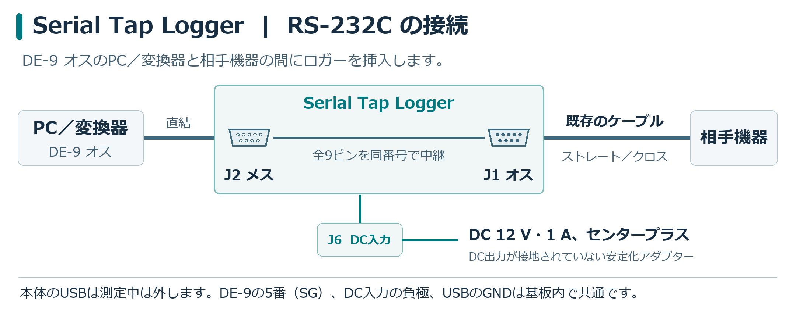

# Serial Tap Logger の配線｜RS-232C

DE-9オスを持つPCまたはRS-232C変換器を例に、既存の通信回線へロガーを挿入します。 液晶を上、DCジャックのある面を手前に置くと、右側面がJ2（メス・穴）、左側面がJ1（オス・ピン）です。図はPCから相手機器までの接続順です。

1. ロガーのUSBを外し、PC・変換器側で既存のRS-232Cケーブルを抜きます。
2. PC・変換器のDE-9オスにロガーの **J2（メス）** を接続し、ロガーの **J1（オス）** に先ほどのケーブルを差します。全9ピンを同じ番号で中継するので、元の回線がストレートでもクロスでも、そのケーブルを使います。
3. **J6（DCジャック）** に、DC出力が接地されていない安定化12 V・1 Aのアダプターを接続します。プラグは外径5.5 mm・内径2.1 mm、センタープラスです。

**送信試験**ではPC・変換器から電文を送り、相手機器からの応答と合わせてロガーで観測します。ロガー自身はRS-232Cの線を受動的に中継・記録するため、送信モードはありません。

DE-9の5番（信号グラウンド、SG）、DC入力の負極、USBのGNDは基板内で共通です。測定中はロガーのUSBをPCから外した状態で使用します。[回路図PDF](Serial_Tap_Logger_RS232C_Rev1.pdf)・[端子と信号の対応](Pin_Mapping.csv)
