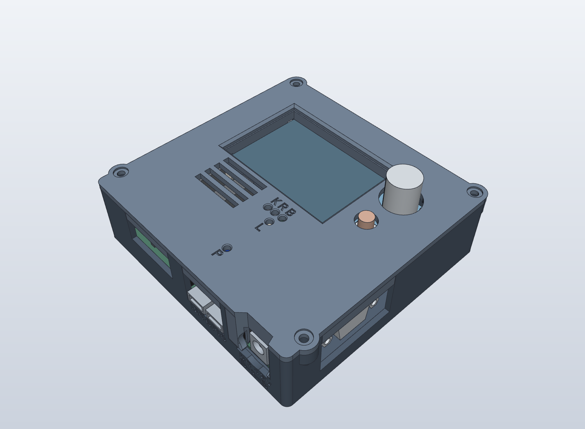

# Serial Tap Loggerの3Dプリント用ケース

100 × 100 mmのRev.1基板を収めるトレーと着脱式の上ぶた。左右にDE-9、前面にUSB-C、Grove 2口、microSD、DCジャックを配置した。上面からLCD、つまみ、モジュールの押しボタン、WeActの操作部を使える。

[ブラウザーでケースを回転して見る](../3d-models/Case_Browser.stl)・[トレーと上ぶたを開いた図](Case_Print_Rev1.png)・[基板を含む組立STEP](../3d-models/Case_Print_Rev1_Assembly.step)

## 印刷と組み立て

印刷用STLは、トレーが底面を下に、上ぶたが刻印のある外面を下にしてある。側面の端子開口はトレー上端まで切り、四隅のボスは壁から斜めに張り出す形にした。材料の目安はPETG。ABSでのスライス条件は下の検証欄を参照。

| 必要なもの | 数 | 仕様 |
|---|---:|---|
| 印刷部品 | 各1 | [トレーSTL](../print/Case_Print_Rev1_Tray.stl)・[上ぶたSTL](../print/Case_Print_Rev1_Lid.stl) |
| ふた用インサート | 4 | M3×0.5、外径4.5 mm、長さ4.0 mm。寸法適合例は東海物産 WB-304540。[メーカー寸法表・熱圧入条件](https://www.tokai-mmc.co.jp/insert/seihin_wb.html) |
| ふた用ねじ | 4 | M3×6 mmのなべ小ねじ。頭径はφ6.4 mmの座ぐりに収まるもの |
| 基板用ねじ | 4 | M3×6 mmの樹脂用タッピングねじ。頭径φ6.0 mm、高さ2.4 mmの想定 |
| 液晶支持部品 | 1組 | 液晶の四隅に樹脂スペーサーを取り付ける。[液晶スペーサーの組立図](RTC_Assembly.md) |

1. トレーに基板を入れる前に、外周のボス4本にインサートを熱圧入する。インサート上端をボスの座面と面一にする。
2. 左右のDE-9を基板に密着させてはんだ付けする。WeAct裏面のVBUS–5Vジャンパは開放にする。液晶を組み、実装済みの基板をトレーへ真上から下ろす。
3. 基板をタッピングねじ4本で固定する。厚さ1.6 mmの基板を通ったねじ先の入りは約4.4 mmで、φ2.5 × 深さ5.5 mmの下穴に収まる。後ろ2本は液晶を付けた状態でも真上からドライバーが入る。
4. 端子と操作部の位置を合わせて上ぶたを載せ、浮きがないことを確認して、M3×6 mmの小ねじ4本で固定する。

## 寸法と固定部

| 部位 | 設計寸法 |
|---|---|
| ケース樹脂部の最大外寸 | 幅121.1 × 奥行114.05 × 高さ32.8 mm |
| トレーの壁・床／上ぶた | トレー2.4 mm、上ぶた2.8 mm |
| インサート固定部 | ボスφ10.3 mm、下穴φ4.1 × 深さ4.5 mm。半径方向の最小肉厚は下穴から3.10 mm、インサート外径φ4.5 mmから2.90 mm |
| ふたのねじ座 | 通し穴φ3.4 mm、座ぐりφ6.4 × 深さ0.8 mm、座面の残り厚2.0 mm。M3×6 mmのねじは座面からボスへ4.0 mm入り、下穴の底まで0.5 mm残る |
| ふたボスの付け根 | 壁の内側から高さ6.0 mmで拡げる。円断面が最も広がる方向の傾きは鉛直から約44° |
| 基板とふたボス | 基板端からボス外周まで最小0.25 mm。基板座標で前2本の中心は (−5.4, 7.0)、(105.4, 7.0)、後ろ2本は (−2.8, 105.4)、(102.8, 105.4) mm |
| ゴム足用の凹み | トレー底面にφ10 × 深さ1.0 mmを4か所 |

トレーには基板のたわみを受ける支柱が4本あり、支柱の上端は基板下面から0.1 mm下にある。液晶右下の支柱にはM3ナットの逃げφ7.4 mmを設け、ナットまで公称0.525 mm、ねじ先まで0.50 mm空けた。DCジャック側の支柱から最寄りの裏面ランドの縁までの平面距離は2.06 mm。

## 端子と操作部

| 部位 | 開口と使い方 |
|---|---|
| 左右のDE-9 | フランジは壁の内面から5.6 mm奥にあり、ケーブルのフードが側面開口に入る。各端子の上に幅1.6 × 長さ28 mmの押さえリブが2本。リブ下端は基板操作面から13.45 mm。端子の図面上限からの余裕はJ1で0.52 mm、J2で0.65 mm。[J1寸法図](https://akizukidenshi.com/goodsaffix/DMR-09PGG_20220218.PDF)・[J2寸法図](https://akizukidenshi.com/goodsaffix/DMR-09SGG.pdf) |
| Grove・USB-C | Groveは正面から左が `I2C`、右が `GPIO`。2口の差込面はケース前面と面一で、共通開口の左右・下端には各0.60 mmの余裕がある。USB-C差込面は前面から4.05 mm奥 |
| microSD | 前面の専用開口から挿抜。差込面は前面から3.91 mm奥 |
| DCジャック | `DC 12V` とセンタープラスの極性記号を刻印。ジャックは主前面から3.10 mmくぼんだ枠の外面と面一。開口はφ15.4 mmで、組立CADでφ14 mmのプラグ握り部が通る |
| LCD | 窓の直線部62 × 43 mm、内側60.9 × 41.9 mm。内壁深さ5.1 mmで液晶基板とピンヘッダを隠す。液晶モジュールとの公称最小すきま0.45 mm。左2本の固定ねじ上にはφ7.0 mmの逃げがあり、ねじ頭まで0.60 mm |
| つまみ・押しボタン | EC11のつまみ用開口はφ18 mm、液晶モジュール上の押しボタン用開口はφ9.5 mm |
| WeActの操作・表示 | `K` はKEY、`R` はRESET、`B` はBOOT。`P` は電源LED、`L` はGP25のLED。穴はφ3.0 mmで入口に0.4 mmの面取り、刻印の深さは0.60 mm。ボタンは上面から約10.5 mm奥にあり、細い樹脂棒などで押す。LEDは真上付近から確認する |
| 電源モジュールPS1 | 上面に25 × 2.8 mmの通気スリットを4本。PS1を基板から0.50 mm浮かせると、ケースまでの公称最小すきまは1.70 mm |

キャリア基板を基準にしたWeActのボタン穴の中心はK (51.99, 38.38)、R (56.06, 38.50)、B (60.37, 38.50) mm。LED窓の中心はP (57.65, 13.02)、L (58.31, 33.49) mm。濃色のケースで刻印を読みやすくするには、組み立て前に溝へ細筆で少量の水性模型塗料を置く。[ABS向け塗料の例と筆塗り方法](https://www.mr-hobby.com/ja/products/detail/110)

## 検証

- C31を含む現行の組立STEPを読み戻し、基板本体と実装部品を合わせた117項目をトレー・上ぶたのそれぞれと照合した。ケース同士を含む235組で体積干渉は0件。
- 単体STEPと組立STEPのケースはどちらも閉じた2ソリッドで、編集モデルの体積と一致する。4本のボス・座面の周囲は5°刻みで肉厚と穴深さを確認した。
- 印刷用STLは各1個の閉じたメッシュ。Bambu Studio 2.7.1.62のX1 Carbon、Generic ABS、0.4 mmノズル、積層0.20 mm、サポートなしでG-codeを生成した。トレー150層、上ぶた110層。[前面・上ぶたの刻印と押出経路](ABS-Port-Markings.png)

試作ではインサートの圧入・引抜強度、ねじの締まり、はんだ付け後のDE-9とふたの嵌合を確かめる。USB-CとGroveを同時に挿した状態でmicroSDを抜き差しできること、DCプラグの差し込み、表示窓・LEDの見え方も実物で確認する。ケースを閉じ、LCDと記録を継続したときの温度上昇は未測定。

## 編集用ファイル

[SolidCraftモデル](../3d-models/Case_Print_Rev1.sc)・[ケース単体STEP](../3d-models/Case_Print_Rev1.step)・[実装済み基板とケースの組立STEP](../3d-models/Case_Print_Rev1_Assembly.step)
