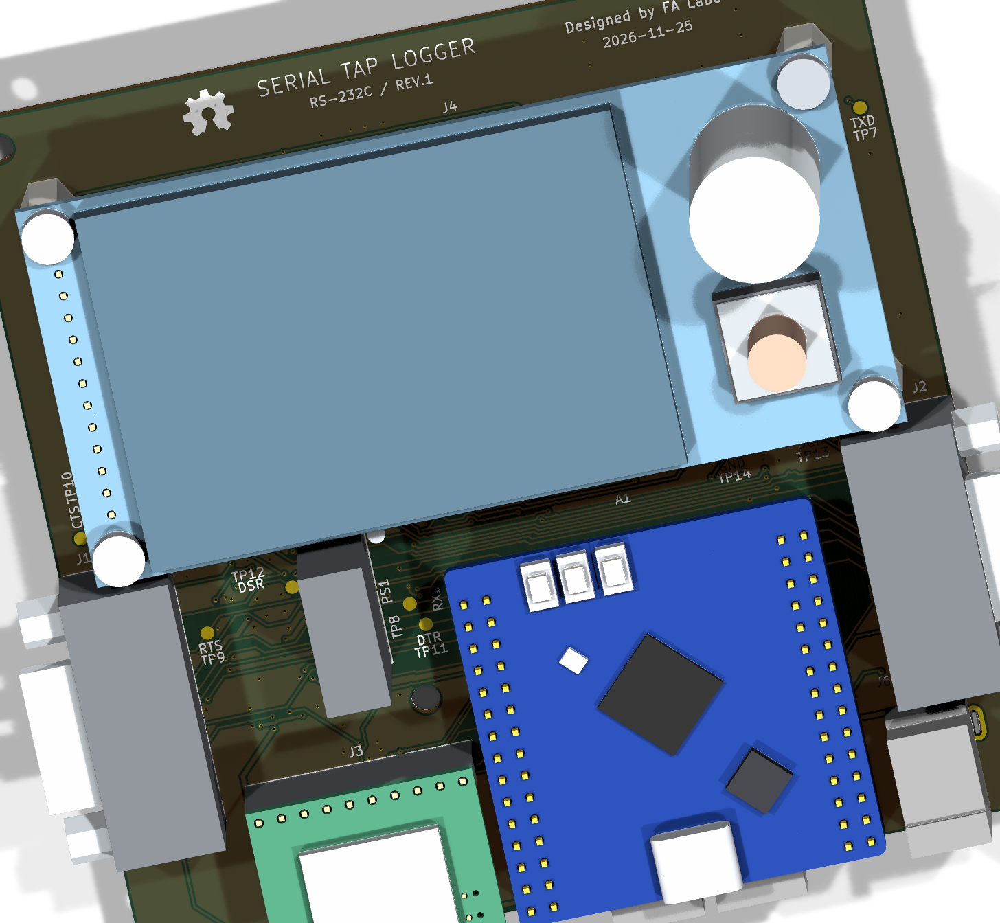
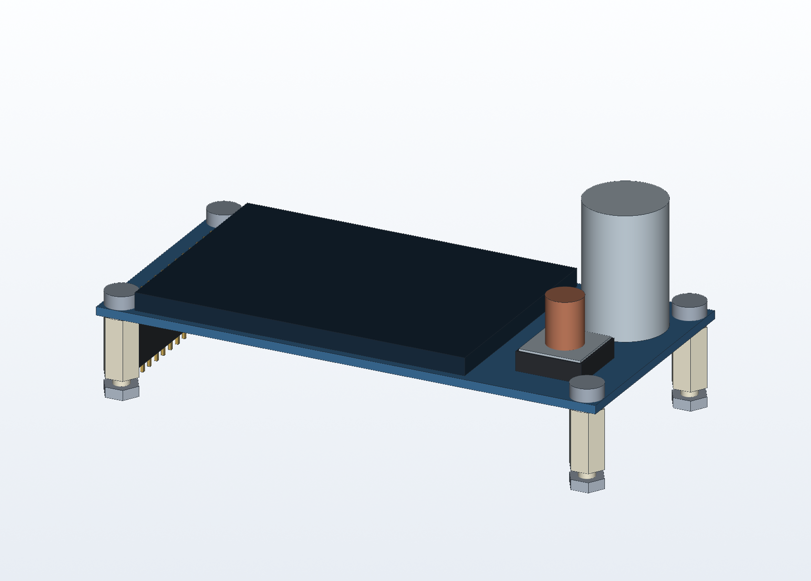

# Serial Tap Logger | RTCと液晶下の組立寸法

RTCのPCF8563Tはキャリア裏面に実装する。水晶Y1の秋月104005はキャリア表面に直立させ、時計保持用の秋月104250は液晶基板の下に平置きする。ケースはトレーと着脱式の上ぶたの2部品。

## 基板とケースの組立モデル

[裏面の3D表示](PCBA_Back.png)も確認できる。KiCadでは基板エディターで `Alt+3` を押すと3Dビューアーが開く。専用STEPは [pcb/3d-models](../../pcb/3d-models/) にあり、裏面の部品はKiCad 10の標準3Dモデルを使う。

液晶基板は四隅のφ3.2 mm穴を使い、M3のナイロン製スペーサーTP-10.8で下から支える。CADでは厚さ0.24 mmの絶縁シムを足し、基板間を11.04 mmに設定した。実物はソケットを自然に差し込んだ状態で高さを測り、すきまに合わせてシムを調整する。上側はM3×5のなべねじ（頭径φ5.8 mm以下、高さ2.40 mm以下）、キャリア裏面はM3の薄形ナット（厚さ1.8 mm）を想定。四隅を軽く仮止めし、液晶基板を反らせずに固定する。[秋月 TP-10.8](https://akizukidenshi.com/catalog/g/g107561/)

基板STEPには表面12点と裏面104点を収録した。追加したC31はRTCのU12に隣接して裏面に実装する。ソケットとヘッダはA1・J3・J4のモデルに含めた。R66は未実装で、テストパッド・取付穴・ロゴは基板の一部。J1・J2・J3・J6・PS1と表示器は外形確認用の簡略モデルを使う。

A1（WeAct RP2350B）は、公開されている寸法とキャリア基板のフットプリントを基に独自に作成した簡略モデル。WeAct社のCADデータは使っていない。モジュール基板は41.38 × 41.12 × 1.6 mm、ヘッダは2.54 mmピッチで60ピン。USB-C、MCU、Flash、水晶、ボタンは干渉確認用の近似形状で、外形の範囲は実物の寸法に合わせた。[STEP](../../pcb/3d-models/WeAct_RP2350B_simplified.step)・[生成スクリプト（CadQuery）](../../pcb/3d-models/WeAct_RP2350B_simplified.py)

| キャリアの操作面をZ=0とした寸法 | mm |
|---|---:|
| LCD用ソケットの高さ | 8.50 |
| LCD基板下面 | 11.04 |
| C27の最大厚さ | 7.90 |
| C27の基板からの浮き許容 | 0.50 |
| LCD下面とC27の最小すきま | 2.64 |

端子の極性をキャリアの角パッド（＋）に合わせ、ケース取付前にC27の基板面からの高さが8.40 mm以下であることを確認する。組立モデル上で実装部品とケースの体積干渉は0件。PS1は基板から0.5 mm浮かせた条件で、3Dプリント用ケースとの最小すきまは1.7 mm。実装高さ、嵌合、部品の外形は購入した実物で照合する。

[実装済み基板STEP](../3d-models/Serial_Tap_Logger_RS232C_Rev1_PCBA.step) ／ [ケース付き組立STEP](../3d-models/Case_Print_Rev1_Assembly.step) ／ [ケースの図と寸法](Case_Print_Rev1.md) ／ [C27部品寸法図](https://akizukidenshi.com/goodsaffix/SE-5R5-D155VYC3H.pdf)
